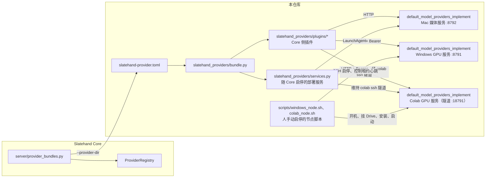
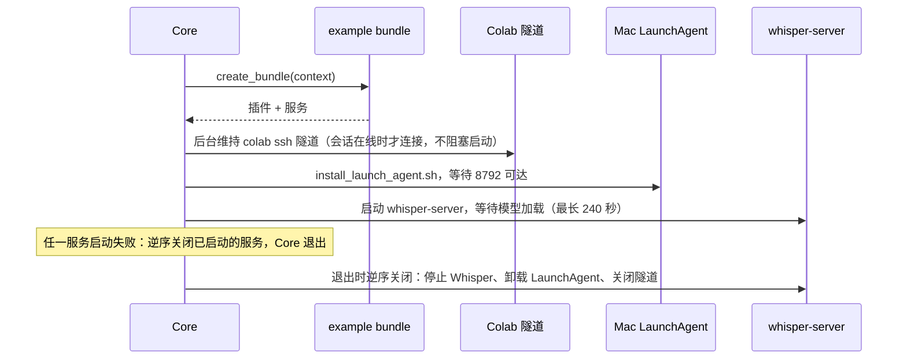

# Slatehand Provider Example

[Slatehand（场记）](https://github.com/Slatehand/slatehand) 作者自用部署的完整 Provider 实现，也是编写自己
Provider 方案时的参考。Core 不认识这里的任何代码：启动时用 `--provider-dir` 指向本目录，Core 读取
[`slatehand-provider.toml`](slatehand-provider.toml)，导入其中声明的 bundle 工厂并安装插件。

## 组成



- `slatehand-provider.toml`：Core 读取的清单（bundle 名、工厂、import 路径、Core 环境需要的额外发行包）。
- `slatehand_providers/plugins/`：每个模型一个插件（manifest、请求翻译、HTTP 调用、随插件发布的提示词 Skill）。
  插件在 Core 进程里运行，只使用标准库与 Core 的 Provider SDK。
- `slatehand_providers/bundle.py`：`example` bundle，按优先级安装插件：Codex 先于 AGY 与 Qwen Image（生图/改图），
  Stable Audio 3 先于 YuE2（文生音频），Breeze 先于 IndexTTS2.5（声音克隆）。
- `slatehand_providers/deployment.py`、`services.py`：读取本机部署配置，并提供随 Core 启停的服务。
- `default_model_providers_implement/`：Mac 与 Windows 上运行的模型服务，独立部署，不 import Core。
  部署、资源调度与各 worker 见其 [README](default_model_providers_implement/README.md)。
- `provider_tests/`：插件、服务、bundle 与黄金请求旅程的测试。
- `scripts/`：工程门禁、真实媒体服务验收脚本，以及手动启停 GPU 节点的 `windows_node.sh`、`colab_node.sh`。

## 工作区与安装

本仓库与 Core 放在同一个工作区，测试会复用 Core 检出目录里的测试支撑：

```text
SlatehandWorkspace/
├── slatehand/                      Core
└── slatehand-providers-example/    本仓库
```

本仓库自己的虚拟环境用于测试和 Mac 模型服务：

```bash
python3.12 -m venv .venv
.venv/bin/pip install -e '../slatehand[dev]' -e '.[services]'
./scripts/check.sh
```

插件只需要标准库与 Core 的 Provider SDK，Core 自己的虚拟环境不需要额外安装任何东西。

## 启动

在 Core 目录：

```bash
./start.sh --provider-dir ../slatehand-providers-example
```

或在 Core 的 `start.local.env` 写 `SLATEHAND_PROVIDER_DIRS=../slatehand-providers-example`，之后直接 `./start.sh`。

## 本机部署配置

bundle 从本目录读取部署配置，全部被 Git 忽略：

- `provider.local.env`：Windows 节点地址（SSH 别名、Windows 上本仓库路径与监听地址只供 `scripts/windows_node.sh`）、
  Colab 会话名、Mac 端口与 Whisper 等，模板见
  [`provider.local.env.example`](provider.local.env.example)；未知键直接报错，同名进程环境变量优先。
- `var/secrets/windows-model-service-token`：Windows 服务的 Bearer Token。只有这个文件存在时才接入 Windows 节点。
- `var/whisper-asr/ggml-large-v3-turbo-q5_0.bin`：本机 Whisper 默认模型。

随 Core 启停的服务按顺序为：



`SLATEHAND_AUTOSTART_MAC_PROVIDER=0` 时不安装 LaunchAgent（非 macOS 上始终不安装）。

## Windows 节点

Windows GPU 服务由人手动启动，Core 只连接：

```bash
./scripts/windows_node.sh up      # 经 SSH 运行 install_scheduled_task.ps1，等 8791 可达后在前台持续心跳，不返回
./scripts/windows_node.sh status
```

没有 down。`up` 最后在当前终端前台运行 `scripts/node_heartbeat.py`，每 5 秒续一次租约（pid 在 Git 忽略的
`var/node-state/`）。Ctrl-C 或关闭终端时心跳释放租约；Windows 服务以 `--exit-when-controller-lost` 运行，租约
一释放（或心跳停止 20 秒，例如 Mac 休眠）就取消任务、释放 GPU 并以退出码 0 结束，守护脚本不再拉起。所以
Windows 节点单独占一个终端。服务未启动时 Core 照常启动，Windows 节点的提交会连接失败。

## 编写自己的 Provider 方案

照这里的结构另起一个目录：根部放 `slatehand-provider.toml`，插件只 import Core 的 Provider SDK，
提供 `create_bundle(context) -> ProviderBundle`，从 `context.provider_directory` 读取自己的配置。步骤与代码骨架见
Core 仓库的 `slatehand-provider-plugin` Skill（`.agents/skills/slatehand-provider-plugin/`）。

## Colab 节点（H3、Breeze TTS 2）

H3 与 Breeze TTS 2 可同时接入本地 Windows 与 Colab（G4，RTX PRO 6000 96 GB）两个节点，在 Provider 设置页
各自的「运行节点」切换。切换只影响新提交；运行中的任务按句柄回到提交时的节点，两个节点互不排斥。

- 接入条件：`var/secrets/colab-model-service-token` 存在，且 `provider.local.env` 设置 `SLATEHAND_COLAB_SESSION`。
  Core 运行期间由 bundle 服务维持 `colab ssh` 隧道（本机 `127.0.0.1:18791` → VM `127.0.0.1:8791`）。
  只在 `colab sessions` 列出该会话时才连接，避免 `colab ssh` 自动开出新的计费 VM；会话不在线时 Core 照常启动，
  只是 Colab 节点的提交会连接失败。
- 开关节点由人手动管理，用 `scripts/colab_node.sh`（需要已安装并登录
  [Colab CLI](https://github.com/googlecolab/google-colab-cli)）。`up` 依次开 G4、挂 Drive（终端里交互授权）、
  同步本仓库 `default_model_providers_implement/` 与 Token，再在 VM 上运行 `colab/setup.sh` 与
  `colab/run_server.sh start`；`down` 回收 VM。Core 不启停 VM、不对 Colab 维持租约。
  每台 Colab 运行时同时只允许一个 `colab ssh` 连接，Core 运行时由隧道占用，所以脚本的远程命令走 kernel 通道
  （`colab exec`）、文件走 `colab upload`，Core 开着也能开机部署；手工 `colab ssh` 调试需先停 Core。
- 权重放在 Drive：`MyDrive/model/minimax-h3/`（与 Windows 节点同一套 DaSiWa Hybrid V2 / Turbo V2 int8、
  官方 Pruned BF16、NVFP4 文本编码器、视频/音频 VAE 与 SelfLift 放大器）与 `MyDrive/model/breeze-tts-2/`
  （首次部署时由 `setup.sh` 从 Hugging Face 固定 revision 下载存入），每次开机复制到 VM 本地盘后加载。
- 开机分两段：前台只复制 Turbo V2 及其共用权重（约 43 GB）就启动服务；Breeze、Hybrid V2 与官方 BF16 在后台
  依次复制（每个文件按 64 MB 分块多线程并行读取，绕开 Drive 挂载的单流限速），完整复制后才链接进模型目录。复制进度以 GB、速度与预计剩余时间显示，前台原地刷新，后台写入
  `/content/slatehand-state/setup-background.log`，`scripts/colab_node.sh status` 显示最新几行。尚未搬完的模型
  被调用时任务直接失败并提示稍后重试。

## Breeze-TTS-2 接入

默认部署用 `SLATEHAND_BREEZE_ENDPOINT`（默认同 Windows 服务地址）连接同一受认证模型服务；Breeze runtime 由 `exclusive_gpu` 调度器按需启动，不会在开机时加载，也不会与 H3 同时驻留。它仍复用已有的 WSL 中已有的 `breeze-tts/.venv` 和模型目录，不会 clone、创建 venv、安装依赖或使用 Docker。手工启动官方 API 仅用于兼容旧部署：

```text
cd ~/ai/breeze-tts
.venv/bin/python -m breeze_infer.api ~/ai/models/Breeze-TTS-2 --host 0.0.0.0 --port 7860
```

随后在 `provider.local.env` 设置 `SLATEHAND_BREEZE_ENDPOINT`。音色设计与声音克隆都走 Breeze TTS 2；Clone/Direction 请求必须保存参考音频完整文字稿。Breeze 只在真实任务期间启动，H3 请求进入队列时调度器先释放 Breeze；不应再注册独立的 `Slatehand Breeze TTS 2` 开机任务。

## Whisper ASR 接入

Whisper 插件连接本机 `whisper.cpp` server，为 Breeze Reference Voice 提供中英文自动转写候选。发现
`whisper-server`（PATH 或 `SLATEHAND_WHISPER_SERVER`）和模型文件（默认 `var/whisper-asr/ggml-large-v3-turbo-q5_0.bin`，
或 `SLATEHAND_WHISPER_MODEL`）时，bundle 随 Core 在 `127.0.0.1:8793` 拉起：

```text
whisper-server --host 127.0.0.1 --port 8793 \
  --model var/whisper-asr/ggml-large-v3-turbo-q5_0.bin \
  --language auto --flash-attn
```

已有自己运行的服务时设置 `SLATEHAND_WHISPER_ENDPOINT`，bundle 只连接、不启停。服务只绑定回环地址。
识别结果仅回填 Web 文本框，用户校对并提交 Breeze 后才进入业务状态；Agent 没有 ASR 入口或自动转写提示。

## 第三方内容

随插件发布的官方 Skill、模板与转谱脚本按各自许可证使用，见 [THIRD_PARTY_NOTICES.md](THIRD_PARTY_NOTICES.md)。
